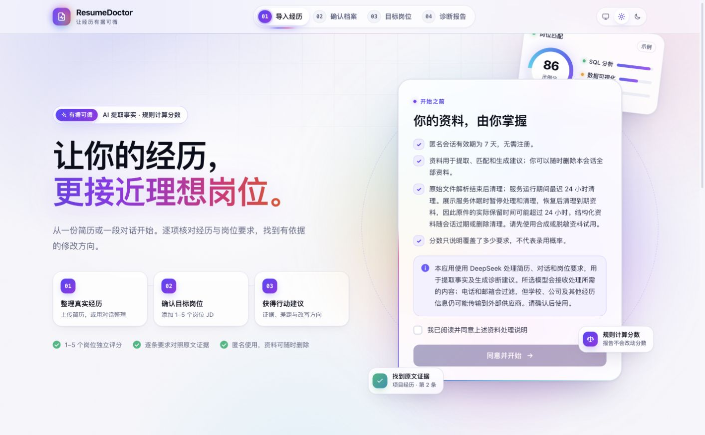
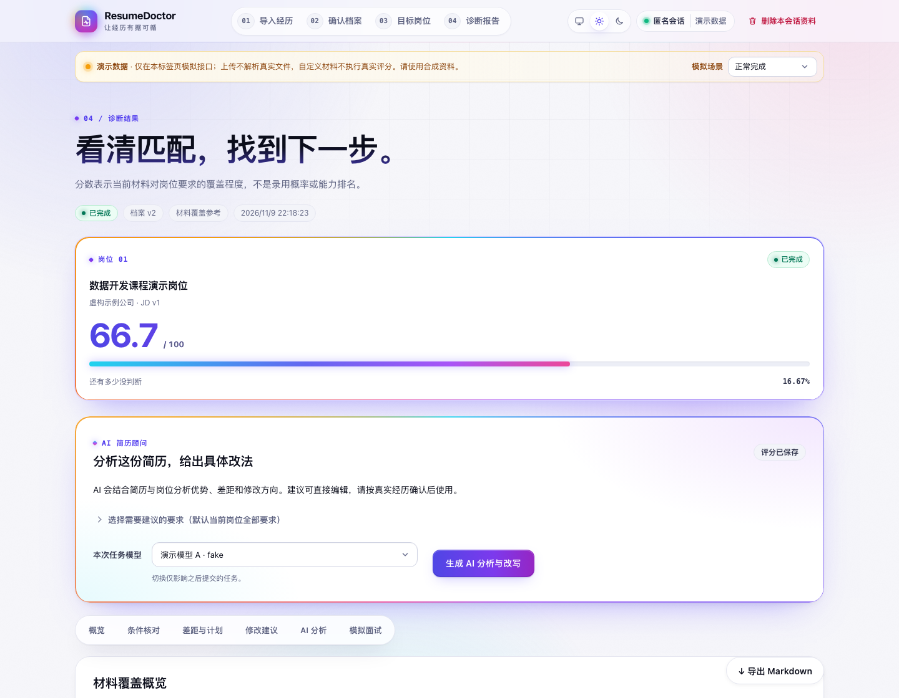

<h1 align="center">ResumeDoctor</h1>

<p align="center"><strong>简历诊断与求职准备工作台</strong></p>

<p align="center">从原文证据出发，看清简历和岗位的匹配程度，找到具体的修改方向。</p>

<p align="center">
  <a href="#主要功能">主要功能</a> ·
  <a href="#本地试用">本地试用</a> ·
  <a href="#技术与文档">技术与文档</a>
</p>

<p align="center">
  
</p>

## 主要功能

| 从哪里开始             | 可以做什么                                                                                         |
| ---------------------- | -------------------------------------------------------------------------------------------------- |
| **整理并确认档案**     | 上传文字 PDF、DOCX，或通过对话补充经历。逐项核对提取结果及其原文出处。                             |
| **对照目标岗位**       | 粘贴职位描述（JD），核对系统提取的岗位要求。一次可对照 1–5 个岗位，每个岗位独立评分。              |
| **查看报告并修改简历** | 查看材料覆盖分、逐条证据和差距。按需生成 AI 分析与改写草稿，核对后编辑、复制或导出 Markdown 报告。 |
| **补充证据与准备面试** | 针对具体要求补充经历，用同一 JD 重新诊断并比较。也可以按档案和岗位练习中英文模拟面试。             |

评分由规则计算，反映当前材料对岗位条件的覆盖程度。缺少证据的要求会标为待确认。模拟面试使用模板出题，改写草稿由用户核对后采用。



_诊断报告示例，使用合成资料。_

## 本地试用

使用 [前端锁定的 Node.js 版本](frontend/.nvmrc)，在仓库根目录执行：

```bash
cd frontend
npm ci
npm run dev
```

打开终端显示的本地地址，阅读并同意资料处理说明。选择「对话整理」并填入合成示例，确认档案后添加示例 JD，即可查看诊断报告。默认使用演示模式，所需数据已随仓库提供，无需启动后端或填写模型密钥。

## 技术与文档

前端使用 **React、TypeScript、Vite**，后端使用 **Python、FastAPI**，由独立 worker 执行后台任务。数据可持久化到 **PostgreSQL**，也支持单机 **SQLite**。

- [前端启动与验证](frontend/README.md#启动)
- [开发环境与前后端联调](docs/08-development.md)
- [系统架构](docs/02-architecture.md) · [API 契约](docs/api/README.md) · [评分规则](docs/05-scoring.md)

## 团队

这是一个已完成的五人协作课程项目，分别负责 Web 前端、后端与集成、资料提取、证据匹配与评分、模型与报告。[分工记录](docs/04-team-plan.md)
