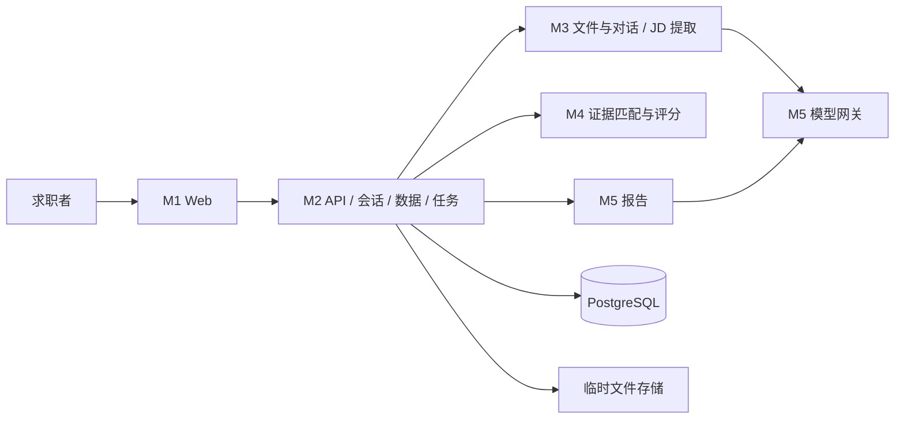

# 架构与模块间契约

## 总体结构

采用单仓库模块化单体，HTTP API 和 worker 共享业务模块与数据库。后端内部使用函数/DTO 协作，不为每个模块另建网络服务。

展示站增加单机 SQLite 适配器，API/独立 worker 共用持久化文件及业务模块；生产数据库
入口按 `DATABASE_URL` 显式选择，不自动降级。展示入口同时提供前端构建产物，进程监督、
休眠与恢复边界见 [展示站部署](11-show-deployment.md)。



## 模块目录与所有权

```text
frontend/src/{pages,components,api,types,lib}/   M1
backend/app/api/                              M2 HTTP 路由和输入验证
backend/app/platform/{sessions,repositories,jobs,storage}/  M2
backend/app/intake/                           M3
backend/app/scoring/                          M4
backend/app/reporting/                        M5
backend/app/llm/                              M5
backend/app/contracts/                        M2 协调，各消费者共同评审
backend/migrations/                          M2
backend/tests/{platform,intake,scoring,llm,reporting}/ 各模块负责
frontend/tests/                               M1
tests/e2e/                                   M1 + E 协调
```

## 内部端口

所有 DTO 对应 `api/openapi.json` 中的 Schema。M2 管理版本和资源 ID；M3/M4/M5 不直接访问数据库，不返回 HTTP 响应，不自行创建会话。下表概括端口职责，具体参数以当前协议和实现为准。

可导入协议位于 [contracts/ports.py](../backend/app/contracts/ports.py)，HTTP DTO 位于 [contracts/models.py](../backend/app/contracts/models.py)。协议采用异步 I/O、同步评分/导出及显式 `TaskContext` 注入；SET-01 的初始消费示例和业务验证责任见 [交付记录](team/set-01.md#内部端口消费)，后续扩展以当前源码与契约测试为准。

| 端口 | 输入 | 输出 | 负责人/调用方 |
|---|---|---|---|
| extract_document | 受限临时文件句柄、媒体类型 | 原始文本、页段定位、warnings | M3 / M2 worker |
| build_profile | 原始文本、来源类型、可选上一 Profile | ProfileContent | M3 / worker |
| advance_conversation | 用户原文、现有 ProfileContent、历史用户轮次；可选 DiagnosisFocusContext / questions_only | assistant_message + ProfileContent | M3 / worker |
| extract_job | JD 原文、公司背景 | JobContent | M3 / worker |
| assess_requirements | 已确认 ProfileContent、JobContent、matcher_version | RequirementAssessment[] | M4 / worker |
| calculate_score | RequirementAssessment[]、rule_version | ScoreResult | M4 / worker |
| generate_report | 已确认快照、ScoreResult、模型元信息 | ReportContent | M5 / worker |
| export_markdown | 已存储 DiagnosisItem | UTF-8 Markdown 文本 | M5 / M2 API |
| generate_structured | task_name、无敏感字段上下文、输出 Schema、超时 | 通过 Schema 的 JSON、model/prompt 元信息 | M5 / M3 或 M5 |

`ProfileContent` 包含 overview、facts、evidence；`JobContent` 包含 requirements、company_context。模型提取证据引用需验证为真实来源子串。M3 不认领最终匹配分，M5 不认领前端报告页面。
M4 v1 使用明确字段、受控同义词和数值条件，不能处理的语义返回 unknown。向量相似度、LLM 直接判分后续再讨论。

## 岗位补充与版本比较

2026-11-05 已在本地实现三项扩展：报告事实审核、岗位定向补充、不同确认档案版本的前后比较。当前对话与报告提示为 `chat-v4`、`report-v3`；本次扩展尚未真实供应商复验或部署至学院服务器。

1. M1 从非 met 的岗位要求进入 `/profiles/:id/follow-up?diagnosis=…&item=…&requirement=…`，仅传资源标识。M2 按会话读取原诊断及冻结 JD，核验同一档案、可评分要求和已有 assessment，再构造 `DiagnosisFocusContext` 交给 M3；不接受客户端提供的事实化岗位上下文。
2. `questions_only=true` 只生成问题，保持原档案内容、版本和确认状态，不写 user 消息；assistant 问题会保存。随后用户提交真实回答，M3 只从用户来源建立证据，内容变化形成未确认草稿。JD、缺口说明和模型问题均不是用户事实来源。
3. M1 在用户确认后，用新档案和原 JD 版本调用既有诊断接口；新报告通过 `?before=原诊断ID&job=岗位ID` 关联比较入口。此参数仅用于导航，不新增报告可变关联或覆盖旧报告。
4. 独立的档案比较组件要求同一 profile ID、不同已确认版本、同一 JD ID/版本、相同 rule_version/matcher_version。逐要求展示两侧保存的状态、理由和各自冻结证据，以及材料覆盖分与未知比例差值；不在前端重新评分，不把 unknown→unmet 描述为能力下降。截止月份变化单独提示。原来的同快照模型比较继续保留，不混用两种比较条件。

报告服务对非 fake 网关要求 `generate_reviewed`：先生成候选并完成确定性检查，再发独立语义审核请求。两阶段使用同一已选模型，共享 45 秒总期限和一次失败重试，正常两个、最多三个 HTTP 请求；审核实质性拒绝不重试，失败保留 score_only。fake 仅用于合成流程与确定性校验，不执行独立语义审核，不能据此宣称建议真实。细节见 [AI 契约](06-ai-contract.md)。

## 版本与状态

档案和岗位的资源 ID 固定，内容版本递增；confirmation 是对指定版本的确认，不覆盖内容。内容编辑携带 base_version，过期返回 409。所有 GET 默认返回 latest_version；历史版本通过 version 查询。
诊断创建时复制指定已确认版本引用，之后编辑不会影响进行中或历史诊断。

任务：queued → running → succeeded / partial / failed。只有诊断任务允许 partial。每岗位结果：pending → scoring → reporting → succeeded / score_only / failed。score_only 表示有评分、无 AI 报告，前端可正常展示和导出规则明细。
诊断聚合：所有岗位 succeeded 则 succeeded；至少一项有评分而非全 succeeded 则 partial；全部无评分则 failed。
解析失败不会产生“确认完成”的档案；对话失败不写半成品消息或草稿版本。

## Worker 与恢复

M2 在事务中创建 queued task，worker 使用行锁领取，记录 attempt、lease_until 和 heartbeat。租约 60 秒、每 15 秒续约；调用模型期间同样续约。失去租约的 worker 不得提交结果，使用 lease_token 校验。
最多 2 次领取；崩溃后租约过期可重新领取，所有结果按 task_id/item_id 唯一键 upsert，不能重复创建档案版本。超过 5 分钟总截止时间终态失败；已完成岗位保留，聚合为 partial。模型内部至多一次重试，计入总截止时间。
删除会话先标记 revoked，所有提交事务再次检查会话有效；取消任务后再清理文件和数据，防止后台重新写回。

JOB-01 的独立进程入口为 `make worker`，与数据库 API 使用相同数据库/上传目录。具体实现、运行恢复说明与实测证据见 [JOB-01](team/job-01.md)。领取与提交均按 session → task → 资源/item 取锁，提交前重新读时钟；网络/模型工作不持有数据库事务。总截止独立计时，心跳自身阻塞时仍先取消业务，再做数据库收尾。崩溃后可能再次请求供应商，持久结果唯一不代表外部调用 exactly-once。

## Mock 与集成

先共同合并 API v0.1 和合成样例。M1 用契约样例搭页面；M3 使用 FakeModelGateway；M4 不依赖数据库或模型；M5 直接消费固定 ScoreResult；M2 用假模块串通任务链。实现阶段再替换真实适配器。
集成顺序：会话/假任务 → 对话建档 → JD → 纯评分 → 报告 → 文件输入 → 端到端。每次只替换一个假模块，保留相同契约。

INT-02 的 API/worker 共用 `app.runtime.business_modules`，默认 GatewayIntake + ScoringService + ReportService，模型为登记素材的 IntegrationFakeGateway。M2 按任务创建 GatewayIntake，将真实 document_id/message_id 绑定为来源，并调用 M3 文档定位 helper；不在共享实例上改变来源。历史 synthetic 装配仅保留在显式 `make dev-synthetic`。
