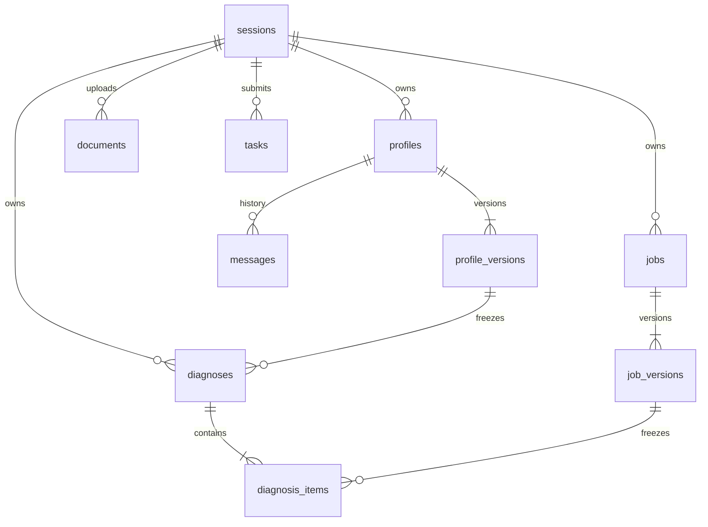

# 数据库设计 v0.1

使用 PostgreSQL；DB-01 的初始迁移为 `backend/migrations/versions/0001_platform.py`，运行和验收见 [DB-01](team/db-01.md)。所有 UUID 由服务端生成，时间为 UTC timestamptz，对外 ISO 8601。内容快照使用 JSONB 并由共享 Schema 校验；表/字段命名 snake_case。

展示站另支持独立 SQLite 模式：相同逻辑表和约束，UUID/JSON 使用 SQLite 兼容类型，
时间统一存为 UTC 并在读取时恢复时区。短事务使用 `BEGIN IMMEDIATE` 替代 PostgreSQL
行锁；初始化/版本不可变触发器独立管理，不运行 PostgreSQL Alembic。初始化、备份和
适用边界见 [展示站部署](11-show-deployment.md)，不自动迁移已有 PostgreSQL 数据。

## 关系

## 通用约定

每张资源表带 session_id（FK sessions.id）、created_at。所有读写按 session_id 过滤；UUID 无法猜测不等于授权。内部复合外键/事务校验保证资源确实属于同一会话。
版本表以 (resource_id, version) 唯一；version 从 1 递增。latest_version 指向已提交完整版本；confirmed_at 可从 null 更新一次，内容不可变。修改已确认内容必须创建新版本。
以下 `?` 表示可空；未标记为非空。数组无数据时为 []，JSON 对象不得保存未验证模型原始输出。

## 表与字段

| 表 | 关键字段与类型 | 约束 / 索引 |
|---|---|---|
| sessions | id uuid PK；token_hash text unique；consent_version text；expires_at timestamp；revoked_at timestamp?；created_at | 服务端只保存随机 cookie token 的哈希；expires_at 索引 |
| profiles | id uuid PK；session_id uuid；latest_version int；created_at | (session_id,id) unique；latest_version>=1；归属复合 FK |
| profile_versions | profile_id uuid；session_id uuid；version int；content jsonb；confirmed_at timestamp?；created_by_task_id uuid?；created_at | PK(profile_id,version)；created_by_task_id unique；FK profiles；content 对应 ProfileContent |
| documents | id uuid PK；session_id uuid；profile_id uuid?；storage_key text?；original_name text；media_type text；size_bytes bigint；status text；deleted_at timestamp?；created_at | size<=10 MiB；状态 stored/processing/parsed/failed/deleted；禁止对外返回 storage_key |
| messages | id uuid PK；session_id uuid；profile_id uuid；task_id uuid；role text；content text；created_at | role=user/assistant；unique(task_id,role)；索引(profile_id,created_at)；只有成功轮次事务写入 |
| jobs | id uuid PK；session_id uuid；latest_version int；created_at | (session_id,id) unique |
| job_versions | job_id uuid；session_id uuid；version int；raw_text text；content jsonb；confirmed_at timestamp?；created_by_task_id uuid?；created_at | PK(job_id,version)；content 对应 JobContent；created_by_task_id unique |
| tasks | id uuid PK；session_id uuid；kind text；status text；input jsonb；result jsonb?；error jsonb?；model_id text；model_snapshot jsonb；attempt int；lease_token uuid?；lease_until timestamp?；heartbeat_at timestamp?；deadline_at timestamp；created_at；updated_at | queued/running/succeeded/partial/failed；索引(status,lease_until,created_at)；input 内含资源版本；不存 token |
| diagnoses | id uuid PK；session_id uuid；task_id uuid unique；profile_id uuid；profile_version int；model_id text；created_at | 复合 FK profile_versions；引用已确认版本；状态从 tasks 读取避免双写 |
| diagnosis_items | id uuid PK；session_id uuid；diagnosis_id uuid；job_id uuid；job_version int；status text；score_result jsonb?；report jsonb?；error jsonb?；model_metadata jsonb?；created_at；updated_at | unique(diagnosis_id,job_id,job_version)；复合 FK job_versions；索引(diagnosis_id) |
| idempotency_keys | session_id uuid；key text；operation text；request_hash text；resource_type text；resource_id uuid；created_at | PK(session_id,key)；24h 清理；operation 与 body 哈希不同返回 409 |
| file_cleanup | storage_key text PK；created_at timestamptz；attempt int；next_attempt_at timestamptz | 基础设施清理队列；只含服务端随机 storage_key 和重试元数据，无会话、文件名、原文；next_attempt_at 索引 |

DB-01 的最小补充是将原有“文件清理队列”落实为 `file_cleanup` 表，使删除失败和文件写入后进程退出都能留下持久重试交接。它不属于对外资源，不带 session_id；其他资源均以会话条件访问。M2 的 worker 在原件解析终态调用 `release_document`，将原件立即交给清理入口；每分钟的清理和 `make cleanup-db` 继续重试。所有进程必须使用同一个私有 UPLOAD_DIR；队列不存任意路径。

初始版本插入使用“父行 latest_version=1 → 完整 version 1 → 提交”；父行到版本的复合外键延迟到提交检查，消除循环引用的插入障碍。内容表的数据库触发器禁止覆盖内容、原始 JD、版本号和创建信息，仅允许 confirmed_at 从 null 变为首次确认时间；重复确认不再次更新时间。

幂等表不增加响应体或状态码字段：固定 operation `profile_create` 对应 201，`job_create`、`chat:<规范小写 UUID>`、`document`、`diagnosis` 对应 202。资源引用足以还原首次响应；建档固定还原不可变 version 1 及初次 confirmed=false，其他请求只返回最初 task_id/diagnosis_id。后续新增返回不同状态码的 operation 时，必须同步该映射、路由和回归测试；若同一 operation 未来可能返回不同成功状态码，再通过新迁移增加存储，不能猜测。上传哈希含文件字节摘要、model_id 和 media_type，不包含客户端文件路径。

model_snapshot 保存 provider、实际 model 名、gateway_config_version 和 prompt_version，不保存凭证。模型列表来自服务端受控配置，不需要模型管理后台/模型表；入队时固定映射，执行前检查仍可用且映射一致，即使管理员之后改列表也不能悄悄换任务模型。

## JSON 数据字典

权威字段和 required 见 [OpenAPI](api/openapi.json)，表中 JSONB 不另创一套字段。
- ProfileContent：overview、as_of_month、facts[]、evidence[]。Fact 含 kind=skill/experience/education/project、label、value（字符串或 null）、polarity=positive/negative、application=applied/claimed、start_month/end_month、completed（布尔或 null）、evidence_ids。
- Evidence：id、source_type=document/message/manual、source_id、quote、locator（页码/段落或 null）。档案内 id 唯一；所有 facts.evidence_ids 必须能解析。
- JobContent：title、company_name、company_context、requirements[]。Requirement 含 id、quote、category、importance、operator、target、subject、ignored、ignore_reason。
- ScoreResult：总分、未知权重比例、版本、assessments、dimensions；报告另存，不覆盖评分。
- 定向对话：MessageCreate 可选 `diagnosis_focus={diagnosis_id,item_id,requirement_id}` 和 `questions_only=false`。任务 input 冻结这些标识及服务端读取的目标上下文；TaskResult 回显目标和提问标记。旧请求省略默认值仍保持原幂等哈希，不需要新增表或列。

学历 value 限 associate/bachelor/master/doctorate/other（kind=education 时校验）。年月 YYYY-MM；区间 [start_month,end_month)；在职经历 end_month=as_of_month，由用户确认此时点。已开始的在读教育（completed=false）允许 end_month 保留原文明示的预计毕业月份，即使其晚于 as_of_month；它不是已完成学历，也不增加工作月份。其他事实的结束月仍不得晚于截止月。缺少日期为 null，不能补造。匹配所需的事实 label 使用受控词典，展示仍保留原文。

## 事务边界

1. 新档案：完整校验后原子插入 profiles + version 1；文件/对话处理先存任务，成功后创建/递增版本。
2. 编辑：锁住父行、比较 base_version、插入新版本、更新 latest_version；竞争失败 409，不覆盖。
3. 确认：只确认 latest_version 且内容完整，历史已确认版本可用于新诊断；重复确认相同版本幂等返回。
4. 诊断：一个事务验证全部资源归属和已确认状态、检查可评分要求、插入 tasks/diagnoses/items/idempotency_keys。任何一个 JD 非法则整体 422，不创建半个诊断。
5. worker：领取和提交均校验 lease_token、会话有效和截止时间。item 独立提交，最终聚合 task 状态；任务 result 引用已有资源，不能复制多份不一致报告。
6. 删除：先使会话失效，撤销运行任务，级联删除 DB 资源；文件删除失败写入只含随机 storage_key 的清理队列（不含个人信息），后台重试。DELETE 返回 204 表示不可再访问；物理文件最迟 24 小时清除。

DB-01 通过会话共享锁保护资源事务，通过会话排他锁协调撤销和新任务数量检查；撤销先记录 revoked_at 并删除资源，定时清理再移除会话墓碑。读取即检查固定 expires_at，不因访问续期。文件清理遵循“清理队列 → documents”的统一锁序。文件写入前独立提交清理预约，预约时间比 24h 上限提前一个 60 秒清理周期，为正常运行的定时器留出执行余量；资源事务回滚或进程在文件落盘后退出，也保留清理依据。租约、领取和恢复逻辑见 JOB-01。

上传先在独立短事务中验证会话并提交随机键清理预约，释放连接后才进入资源/幂等事务；不在持有连接时向同一池申请第二条连接。只有幂等竞争胜者写文件并创建 document/task；重放或回滚后移除未使用的预约。删除文件失败则保留已提交的预约并尝试提前重试，数据库暂时不可用也不丢失原预约。未使用预约的删除失败只留无文件的清理项，不改变已提交响应。

JOB-01 使用现有租约列，无新迁移。领取 session → task SKIP LOCKED，提交在同一短事务内校验有效会话、running、token、租约及总截止，取得资源锁后提交前再次检查时间。版本/消息与普通任务结果同事务；诊断先提交 score，再逐项提交报告/错误，所有 item 终态后才聚合 task。重领不覆盖既有分数和终态项。原无 fencing 的 worker 写入口已封堵；人工创建/编辑不允许通过传 created_by_task_id 冒充后台结果。细节与边界见 [JOB-01](team/job-01.md)。

## 清理与隔离

sessions 七天固定过期；原件解析终态即删除，异常最迟 24 小时清除；结构化数据、对话和报告随会话删除。实施定时清理不能依赖用户主动点击。原始文本在快照/消息中仍属个人数据，生命周期同会话。
上传文件不放公共静态目录，随机存储名，防路径穿越；PDF 解码/DOCX 解压有时间和展开大小限制。持久化层与模型日志不记录原文；错误日志只有 request_id/task_id、错误码和技术堆栈的脱敏信息。
迁移只由 A 合并编号，任何成员改 JSON 结构都同步 OpenAPI、示例、版本策略与测试。

INT-02 在任务 JSONB input 内冻结本轮 message_id，成功提交消息时复用该编号；旧已排队任务使用 task_id 作为消息编号，保持证据与实际消息一致。文档解析提示保存于 task.result.warnings，与档案写入同一受租约保护事务；无新增表或列。

## 岗位定向补充的持久化边界

2026-11-05 的本地实现复用现有 profile_chat 任务、版本表和消息表。入队与 worker 读取目标时均按会话解析诊断、岗位项和冻结 JD；同一档案、要求归属和非 met 状态不能只依赖浏览器检查。

`questions_only=true` 的提交事务校验返回内容与原档案完全相同，只保存 assistant 消息和任务结果，不保存 user 消息，不递增档案版本，不改变确认状态。它仍是受任务限流与对话预算约束的处理轮次。真正的用户回答按原规则保存 user/assistant 消息；内容有变化时原子追加未确认版本，不能把模型问题或 JD 文本当作用户回答写入事实。

前后比较只读取既有诊断和不可变档案/JD 版本，不新增可修改的“改进分数”或改写旧报告。报告独立事实审核在持久化候选报告之前完成；拒绝时保留已经提交的确定性评分。fake 演示不提供语义审核真实性保证。本轮没有新增数据库迁移；本地实现不代表真实供应商或学院服务器已完成发布验收。

## 结构化条件 v2 快照兼容

新字段均进入既有 JSON 快照，无新增 SQL 列或迁移。旧快照缺少 attributes/condition/unknown_reason/counted_in_score/scorable_weight_ratio 时由 DTO 兼容默认值读取，不回写原记录；旧报告不重算。新诊断由 worker 使用 coverage-v2/matcher-v2 并保存评分范围。
