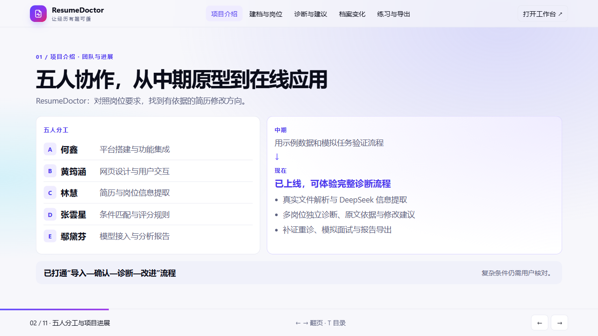

# 期末汇报：项目介绍与展示页发布交接

本次由 C（林慧）提出并确认：第一位同学用约 1–2 分钟介绍团队分工、项目进展和重点优化，随后由第二位同学演示网页。沿用现有展示页的视觉模板，不新增业务功能。

## 页面与范围

- 首页右上角「项目展示」在新标签页打开 `/showcase/index.html`，保留当前工作台。
- 封面后的第一页是「五人分工与项目进展」，直接定位：`/showcase/index.html#team-progress`。
- 第二页是「重点优化」，直接定位：`/showcase/index.html#improvements`。
- 第二页的「进入功能演示」按钮跳到原有导入演示，原来的案例、岗位切换、补证回放、模拟面试和示例下载继续保留。
- 展示页依然支持左右方向键翻页，按 T 回到原有流程目录。

原线上展示页在本次基线 `401162c` 中尚未保存为源码。本次从已登录的 `https://mf18.show.lingnan.top/showcase/index.html` 恢复现有展示资源到 `frontend/public/showcase/`，以便之后从主分支正常构建、发布。原有 JavaScript、主题、主样式及案例数据保持不变；新增两页使用单独的 `intro-pages.css`。示例 DOCX 是线上原有的合成简历，明确标注虚构公司，不包含用户提供的真实简历。

没有修改后端、评分、数据库、依赖或模型配置；没有调用真实模型，也没有发布线上。

## 验证记录

- `npm run build`：TypeScript 检查与生产构建通过。
- `python scripts/package_show.py --output output/deployment/resumedoctor-showcase.zip`：标准部署包构建成功；核对展示目录内全部 12 个文件均包含在 ZIP 中。
- 在本机 Chrome 对最终生产构建检查：首页入口在新标签页打开；封面能进入新介绍页；方向键、T 目录可用；两页在 1280×720、1920×1080 的浅色和深色主题下均完整显示。
- 原有岗位切换、补证回放、中英文面试切换和页内链接已核对；合成 DOCX 和 Markdown 报告下载正常。
- 本次只验证展示页面和发布资源，没有重做真实模型及后端业务验收。

预览图：

## 交给 A 发布

用户要求由 A（`Riverstar123`）审查并部署。请先合并 PR，再在最新主分支运行项目的标准打包脚本并重新部署到 mf18。发布步骤和服务端配置沿用 [展示站部署说明](../11-show-deployment.md)，不要将部署令牌或模型密钥写入源码、PR 或打包文件。

发布会重启应用，请避开正在进行的现场演示。请重新打包而非使用 PR 合并前的旧 ZIP，以免遗漏新文件。沿用既有服务端配置和 `/data`，不需要数据库迁移。

发布后验收：

1. 首页右上角可以打开「项目展示」。
2. 封面点「开始展示」能看到五人分工和进展，再翻一页能看到五项优化。
3. 点「进入功能演示」仍可接着演示原有内容，并可下载合成简历和示例报告。
4. 核对上述两个直接定位链接。如仍显示旧页面，请强制刷新后复验。
